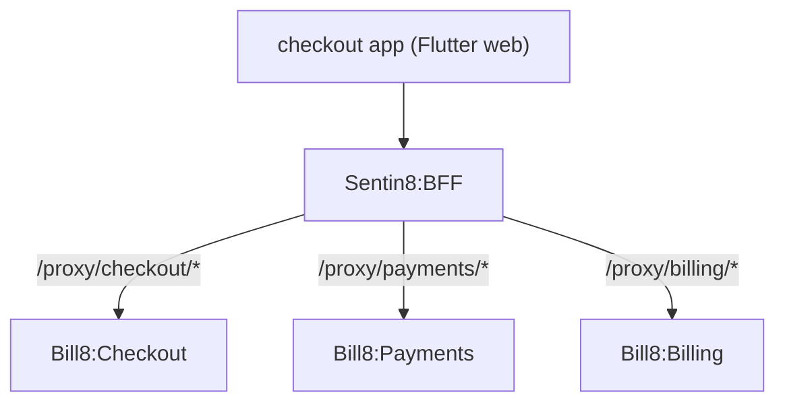

# Bill8:Checkout - Flutter App

The hosted payment surface: payment pages and links rendered for the
customer.

## 1. Summary

Bill8:Checkout is the customer-facing Flutter app that renders
hosted payment pages. It serves the page definitions supplied by the
checkout service and completes sessions through the BFF proxy.

## 2. Motivation

Card-handling UI lives in one place - this app - so merchants never
build payment pages. Hosted pages keep card data in one surface and
simplify compliance.

## 3. Architecture & High-Level Design

## 4. Key Traits and Data Structures

- `Bff8ApiClient` - shared BFF client.
- Page renderer driven by session definitions.

## 5. Rationale, Trade-offs, and Alternatives

- **Hosted over embedded SDK**: one card-handling surface.

## 6. Internal Implementation & Invariants

- All calls route through `Bff8ApiClient`.

## 7. Unresolved Questions / Future Designs

- See the vertical `backlog.md`.

---

**Architecture & Design:** bill8:checkout and its underlying concepts were designed by [Hamid Jahanzad](https://www.linkedin.com/in/hamidjahanzad/).
